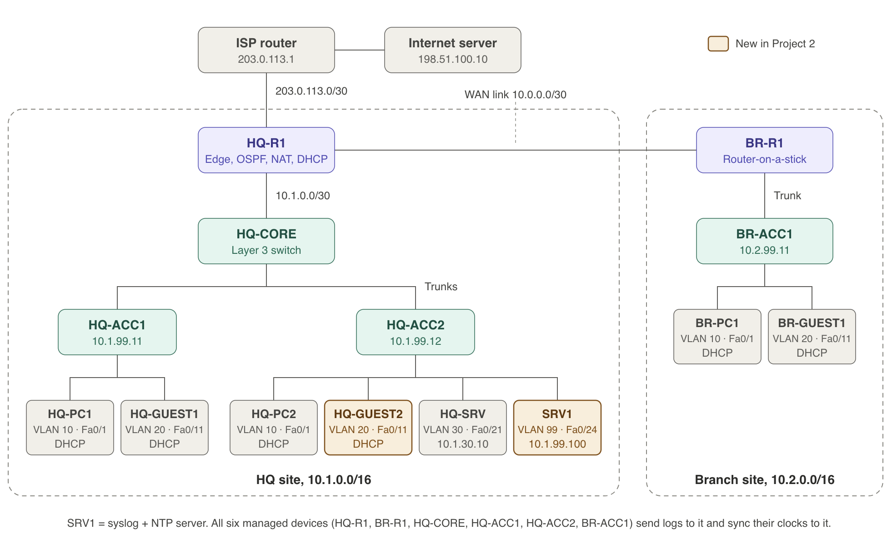
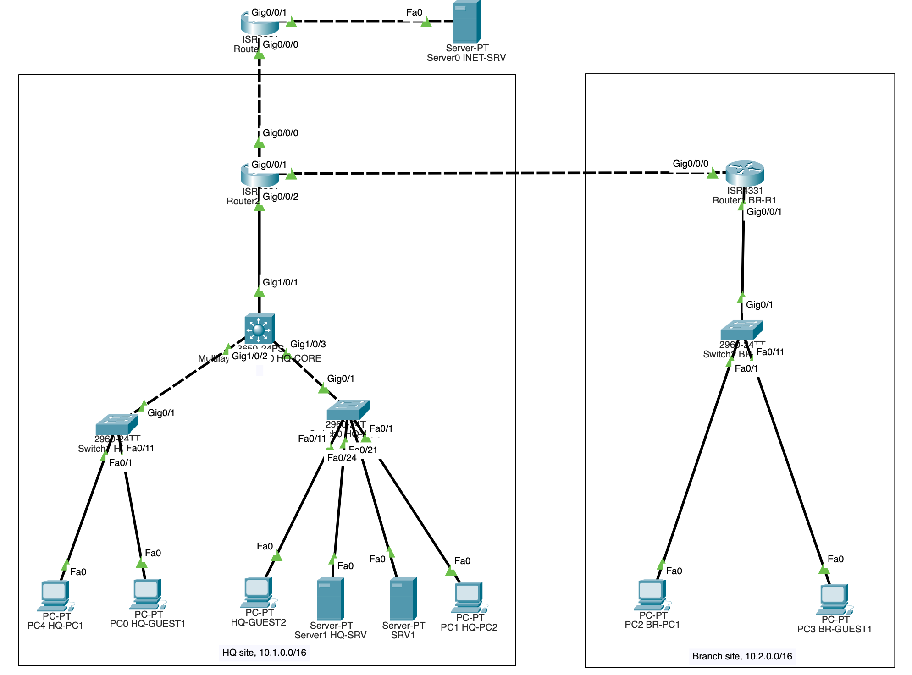

# Network Troubleshooting Lab

A NOC-style troubleshooting lab in Cisco Packet Tracer. I added centralized logging and time sync to my [Two-Site Enterprise Network](https://github.com/farahmassuh-ai/two-site-enterprise-network), recorded a known-good baseline, then broke the network one fault at a time and fixed each fault from the user's complaint, the logs and `show` commands. Every fault is documented as an incident ticket.



*Amber devices were added for this project: SRV1 (syslog and NTP server) and HQ-GUEST2 (a second HQ guest PC).*



*The same network running in Packet Tracer (`network-baseline.pkt`).*

---

## What this project demonstrates

| Skill | Where |
|---|---|
| **Structured troubleshooting** | The same 7-step method on every ticket ([method](#method)) |
| **Log analysis** | Syslog from all six managed devices to SRV1; the logs gave the first clue in three of the five tickets |
| **Baselining** | Known-good `show` output, configs and a 12-row test matrix in [`baseline/`](baseline/) |
| **Incident documentation** | Five tickets in [`tickets/`](tickets/), each with impact, logs, steps, root cause, fix, verification and prevention |
| **Layer-by-layer diagnosis** | Faults at the access port, trunk, native VLAN, DHCP relay and OSPF layers |
| **Operational habits** | A [runbook](runbook.md) that grew with every ticket |

---

## Incident tickets

| Ticket | Reported symptom | Root cause | Layer / area | First clue |
|---|---|---|---|---|
| [INC-001](tickets/INC-001.md) | HQ-PC2 has no network access | HQ-ACC2 Fa0/1 (HQ-PC2's port) shut down | Layer 1 / Access | Syslog: "administratively down" |
| [INC-002](tickets/INC-002.md) | HQ-GUEST2 gets no IP address; HQ-GUEST1 is fine | VLAN 20 removed from HQ-CORE's trunk to HQ-ACC2 | Layer 2 / Trunk | Comparing the working and broken guest |
| [INC-003](tickets/INC-003.md) | Repeated warning on HQ-CORE and HQ-ACC1; users fine | Native VLAN mismatch on the HQ-CORE ↔ HQ-ACC1 trunk | Layer 2 / Trunk, STP | Syslog: CDP and STP warnings |
| [INC-004](tickets/INC-004.md) | HQ guest PCs show 169.254.x.x | `ip helper-address` removed from HQ-CORE Vlan20 | Services / DHCP relay | Only one VLAN at one site affected |
| [INC-005](tickets/INC-005.md) | HQ can't reach the branch; each site works internally | BR-R1's WAN interface made OSPF-passive | Layer 3 / OSPF | Syslog: OSPF adjacency down |

---

## Method

1. **Define** the problem: who is affected, what fails, since when.
2. **Check the logs** on SRV1 for anything that changed around that time.
3. **Work up the layers:** link up? Right VLAN? Correct IP and gateway? Route to the destination? Anything filtering it?
4. **Compare with the baseline** to see exactly what's different.
5. **Fix the root cause**, not just the symptom.
6. **Verify** that the affected user works again and nothing else broke.
7. **Document** it as a ticket.

The [runbook](runbook.md) maps common symptoms to the first commands to run, plus lessons learned from each ticket.

---

## What changed from Project 1

| Change | Details |
|---|---|
| **SRV1** (new) | Syslog and NTP server, 10.1.99.100/24, gateway 10.1.99.1, on HQ-ACC2 Fa0/24, which was moved from VLAN 30 to the management VLAN 99 |
| **HQ-GUEST2** (new) | Guest PC on HQ-ACC2 Fa0/11 (DHCP), so each HQ access switch has a guest |
| **Logging** | `logging 10.1.99.100` and `service timestamps log datetime msec` on all six managed devices |
| **Time sync** | `ntp server 10.1.99.100` on all six; all accepted it, so no clocks were set by hand |

GUEST-IN already blocks both guest VLANs from 10.0.0.0/8, so guests can't reach SRV1. Logs and NTP from the network devices aren't affected.

**How devices appear on SRV1:** syslog shows the sending interface's address, not the hostname.

| Device | Appears as |
|---|---|
| HQ-R1 | 10.1.0.1 |
| HQ-CORE | 10.1.99.1 |
| HQ-ACC1 / HQ-ACC2 | 10.1.99.11 / 10.1.99.12 |
| BR-R1 | 10.0.0.2 |
| BR-ACC1 | 10.2.99.11 |

---

## Baseline and verification

[`baseline/`](baseline/) holds the healthy state: 25 `show` outputs, the running config of all six devices, and the [test matrix](baseline/test-matrix.md). All 12 rows passed before any fault was injected.

After each ticket, a 4-check smoke test confirmed nothing else broke:

| Check | Expected |
|---|---|
| HQ-PC1 → HQ-SRV (10.1.30.10) | Replies |
| BR-PC1 → HQ-SRV | Replies (crosses the WAN) |
| Guest → internet (198.51.100.10) | Replies |
| Guest → HQ-SRV | Blocked by GUEST-IN |

After all five tickets were fixed, the full 12-row test matrix was rerun and **all 12 rows passed**.

---

## Repository structure

```
├── README.md
├── runbook.md                     # Symptoms → first commands, lessons learned
├── diagrams/topology.png          # Logical topology
├── baseline/                      # Known-good state (see baseline/README.md)
│   ├── test-matrix.md
│   ├── configs/                   # Running config of all six devices
│   └── *.txt                      # show command output per device
├── tickets/                       # INC-001.md to INC-005.md
└── packet-tracer/
    ├── troubleshooting-lab.pkt    # The lab network (healthy)
    └── network-baseline.pkt       # Clean copy, reopened before every ticket
```

---

## Running the lab

1. Open `packet-tracer/network-baseline.pkt` in Cisco Packet Tracer 9.0.1 or later.
2. Lab-only credentials (practice values): console `cisco`, enable secret `class`, SSH user `admin` / `class`.
3. Logs: SRV1 → Services → SYSLOG.
4. To reproduce a ticket, apply the change described in its Root cause section, then work from the reported symptom.

---

## Packet Tracer notes

- `terminal length 0` isn't supported; press Space at `--More--` to see full output.
- HQ-R1's route ages display as very large numbers after the NTP clock change. This looks like a display glitch; routes and forwarding are correct.
- Syslog uses UDP, so a message sent before ARP resolves is lost and never resent.

---

## About

Built while preparing for the Cisco CCNA (200-301). Follows my [Two-Site Enterprise Network](https://github.com/farahmassuh-ai/two-site-enterprise-network) project.
